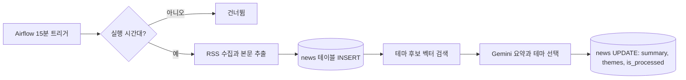

<div align="center">

# Stocker

**국내 경제 뉴스를 자동 수집하고, LLM으로 요약하고, 관련 산업 테마를 붙이는 뉴스 파이프라인.**


</div>

하루에 나오는 경제 기사를 일일이 읽기 어려운 문제를 줄이려는 프로젝트다. 기사를 주기적으로 모으고, 기사마다 3~4문장 요약과 WICS 기반 테마(최대 3개)를 생성해 DB에 저장한다. 종목을 추천하지 않는다. 뉴스와 테마의 연결 정보만 제공하는 것이 목적이다.

> 현재 레포에는 수집과 분석 파이프라인만 구현되어 있다. 백엔드 API와 모바일 앱 코드는 레포에 아직 없다(빈 파일). [한계](#한계) 참고.

## 목차

- [기능](#기능)
- [동작 방식](#동작-방식)
- [빠른 시작](#빠른-시작)
- [사용 흐름](#사용-흐름)
- [설정](#설정)
- [한계](#한계)
- [내부 구조](#내부-구조)
- [개발](#개발)

## 기능

| 기능 | 내용 |
| --- | --- |
| 뉴스 수집 | RSS 피드에서 기사 목록을 받고, 기사 본문을 비동기로 가져온다. 현재 RSS 대상은 한국경제 경제 피드 1개이고, 실행마다 최대 10건을 가져온다. 본문 추출에 실패한 기사는 저장하지 않는다. |
| 중복 방지 | `news.url`에 UNIQUE 제약을 두고 `ON CONFLICT DO NOTHING`으로 적재한다. |
| LLM 요약과 테마 | `gemini-2.5-flash-lite`가 기사 본문을 3~4문장으로 요약하고 테마를 최대 3개 고른다. |
| 테마 후보 검색 | WICS 세분류 151개의 설명 CSV(`pipeline/data/themes.csv`)를 임베딩해 Supabase 벡터 DB(`wics_documents`)에 넣고, 기사마다 상위 10개 후보를 검색해 LLM에 넘긴다. |
| 시간대별 스케줄 | Airflow DAG가 15분마다 실행되며, 장 전후 15분 간격과 그 밖의 시간대 정시 실행을 KST 기준으로 걸러낸다. |
| DB 스키마 | `users`, `news`, `stocks`, `news_stock_map`, `user_bookmarks` 테이블, `wics_documents` 테이블, 벡터 검색 함수를 마이그레이션 파일로 제공한다. |

## 동작 방식



Airflow가 두 태스크를 순서대로 실행한다. `crawl_news`가 기사를 DB에 넣고, `analyze_news`가 `is_processed = false`인 기사를 처리한다. 분석 단계는 기사마다 호출 뒤 10초(실패하면 2초)를 기다린다.

## 빠른 시작

### 요구 환경

- Docker, Docker Compose
- Supabase 프로젝트 (PostgreSQL, pgvector 사용)
- Google Gemini API 키
- Python 3.12 (테마 벡터 적재를 로컬에서 실행할 때)

### 1. 환경 변수

`.env.example`을 `.env`로 복사하고 값을 채운다. 키 이름은 [설정](#설정)을 참고한다.

```bash
cp .env.example .env
```

### 2. Supabase 마이그레이션

먼저 Supabase에서 `vector` 확장(필요하면 `uuid-ossp`도)을 켠다. `002_enable_pgvector.sql`은 이름과 달리 `create extension vector`를 포함하지 않고 `uuid_generate_v4()`를 쓴다.

Supabase SQL 편집기에서 아래 순서로 실행한다.

1. `supabase/migrations/001_init.sql`: 테이블과 인덱스 생성
2. `supabase/migrations/002_enable_pgvector.sql`: `wics_documents` 테이블과 `match_documents` 함수 생성 (임베딩 차원 3072)

주의: 002는 맨 앞에서 기존 `wics_documents` 테이블과 `match_documents` 함수를 DROP하고 다시 만든다. 다시 실행하면 적재한 벡터가 지워진다.

### 3. 테마 벡터 적재 (1회)

`pipeline/processors/init_vector_db.py`는 `themes.csv`를 읽어 `wics_documents`에 임베딩을 넣는 1회성 스크립트다. 실행 전 `.env`와 로컬 의존성 설치가 필요하다. 의존성은 Airflow 이미지 안에만 설치되므로 로컬에 따로 설치한다.

```bash
pip install -r requirements.txt
python -m pipeline.processors.init_vector_db
```

### 4. Airflow 실행

```bash
docker compose up -d airflow-db
docker compose up airflow-init
docker compose up -d airflow-webserver airflow-scheduler
```

Airflow 웹 UI는 `http://localhost:8080`에서 열린다. DAG 이름은 `stocker_news_pipeline`이다.

## 사용 흐름

1. `.env`를 채우고 Supabase 마이그레이션을 실행한다.
2. 테마 벡터를 1회 적재한다.
3. Airflow를 띄우고 `stocker_news_pipeline` DAG를 켠다.
4. 결과는 Supabase의 `news` 테이블에서 확인한다. `summary`, `themes`, `is_processed` 열이 갱신된다.

## 설정

| 키 | 의미 |
| --- | --- |
| `DB_HOST`, `DB_PORT`, `DB_NAME`, `DB_USER`, `DB_PASSWORD` | Supabase PostgreSQL 접속 정보 (psycopg2) |
| `SUPABASE_URL`, `SUPABASE_KEY` | Supabase 클라이언트와 벡터 검색용 |
| `GEMINI_API_KEY` | `.env.example`에 있는 Gemini 키 이름. 코드가 직접 읽지는 않는다. 아래 "미확인·제외" 참고. |

주의할 점:

- `docker-compose.yaml`의 Airflow 초기화 명령은 관리자 계정을 고정값으로 만든다. 실제 운영 전에 바꿔야 한다. Airflow 메타 DB도 5433 포트에 고정 계정으로 열린다.
- 크롤러는 SSL 인증서 검증을 끄고 있다(`verify_mode = CERT_NONE`). 외부에 노출되는 환경에서는 이 설정을 검토해야 한다.
- `.env`는 Git에 올리지 않는다(`.gitignore`에 포함).

## 한계

- 종목 매핑(`stocks`, `news_stock_map`)은 스키마만 있고 채우는 코드가 없다. 기사와 종목을 연결하는 기능은 현재 동작하지 않는다.
- 뉴스 소스가 한국경제 RSS 1개뿐이다. `PARSING_RULES`에 매체 규칙이 3개 있지만 RSS 대상이 없는 나머지 두 규칙은 실행되지 않는다.
- 테마는 `themes` JSONB 열에 쉼표로 이은 문자열 하나로 저장된다.
- `news`의 `sentiment*` 열은 채우는 코드가 없다.
- 요약과 테마는 LLM이 만든 결과다. 사실과 다를 수 있으므로 원문을 확인해야 한다. 투자 판단의 근거로 쓰기에 적합하지 않다.
- 테스트 코드가 레포에 없다.
- 백엔드 API(`backend/main.py`, `backend/api/*.py`), `deployment/Dockerfile.backend`, `supabase/seed.sql`은 0바이트 빈 파일이다. 앱 코드는 없다.
- 일일 수집 건수, LLM 분석 성공률, API 응답 시간의 측정 기록이 레포에 없다.

<details>
<summary>미확인·제외</summary>

미확인:

- `GEMINI_API_KEY`만으로 Gemini 호출이 인식되는지 확인하지 않았다. 코드는 이 이름을 직접 읽지 않고 `ChatGoogleGenerativeAI`, `GoogleGenerativeAIEmbeddings`가 환경 변수에서 키를 찾는다. langchain-google-genai의 기본 이름은 `GOOGLE_API_KEY`이고, 대체 이름 지원은 버전에 따라 다르다(`requirements.txt`가 버전을 고정하지 않는다). 안 되면 `GOOGLE_API_KEY`도 설정한다.
- Airflow 초기화 후 실제 DAG 실행 여부. 로컬 실행은 하지 않았다.

제외:

- 종목 추천과 수익률 예측은 범위 밖이다.

</details>

## 내부 구조

<details>
<summary>폴더 구조와 주요 모듈</summary>

```
stocker-news-crawling-system/
├── dags/
│   └── pipeline.py              # stocker_news_pipeline DAG (15분 트리거, 시간대 체크, 크롤링, 분석)
├── pipeline/
│   ├── config.py                # 경로 상수
│   ├── crawlers/crawler.py      # RSS 수집, 본문 추출(비동기), news 적재
│   ├── processors/
│   │   ├── analyzer.py          # 벡터 검색 + Gemini 요약과 테마 선택, news 갱신
│   │   └── init_vector_db.py    # themes.csv 임베딩 적재 (1회성)
│   ├── utils/db.py              # psycopg2 연결, Supabase 클라이언트, upload_news
│   └── data/themes.csv          # WICS 테마 설명 (포함과 제외 조건)
├── backend/                     # main.py, api/news.py, api/stocks.py (빈 파일)
├── supabase/
│   ├── migrations/              # 001_init.sql, 002_enable_pgvector.sql
│   └── seed.sql                 # 빈 파일
├── deployment/                  # Dockerfile.airflow, Dockerfile.backend (빈 파일)
├── docker-compose.yaml          # airflow-db, airflow-init, webserver, scheduler
└── requirements.txt
```

</details>

## 개발

- 로컬에서 수집만 실행: `python -m pipeline.crawlers.crawler`
- 로컬에서 분석만 실행: `python -m pipeline.processors.analyzer`
- 패키지 설치: `pip install -r requirements.txt` 후 `pip install -e .` (`setup.py`의 `stocker_pipeline`. `install_requires`가 없어 의존성은 따로 설치한다)

## 라이선스

레포에 LICENSE 파일이 없다. 사용 조건은 정해지지 않았다.
